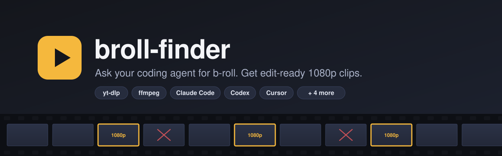
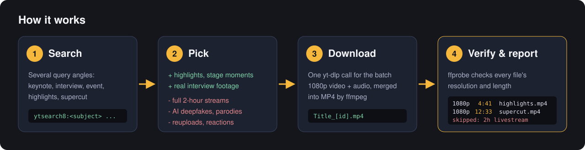
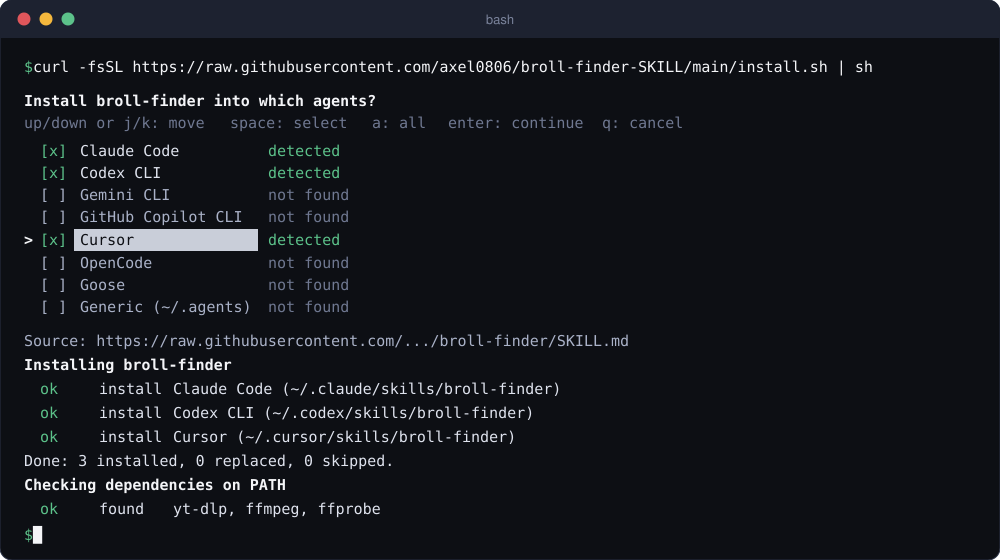

<p align="center">
  
</p>

# B-Roll Finder (`broll-finder`)

An agent skill that finds and downloads b-roll video clips of a person, event, or topic with yt-dlp, ready to drop into your video editor. It works with Claude Code, Codex, Cursor, and other agents that support skills.

Ask *"find b-roll of <person> and download it into this folder"*. The agent searches, picks clips that are actually usable, downloads them as 1080p MP4, checks every file, and tells you what it skipped and why.

<p align="center">
  
</p>

## Requirements
- [yt-dlp](https://github.com/yt-dlp/yt-dlp)
- [ffmpeg](https://ffmpeg.org/), including ffprobe
- Optional: [deno](https://deno.com/), for formats that need a JavaScript runtime

Both installers check that `yt-dlp`, `ffmpeg` and `ffprobe` are on your PATH. They show where each one was found, or print the install command for any that are missing.

## Install
**macOS, Linux, Git Bash:**
```bash
curl -fsSL https://raw.githubusercontent.com/axel0806/broll-finder-SKILL/main/install.sh | sh
```

**Windows PowerShell:**
```powershell
& ([scriptblock]::Create((irm https://raw.githubusercontent.com/axel0806/broll-finder-SKILL/main/install.ps1)))
```

When you run it in a terminal, it lists the agents it found and asks which ones to install into. Pressing Enter installs into every detected agent. Without a terminal, for example in CI, it installs into every detected agent without asking.

<p align="center">
  
</p>

To choose agents yourself, add them to the command:
```bash
curl -fsSL https://raw.githubusercontent.com/axel0806/broll-finder-SKILL/main/install.sh | sh -s -- --agent claude,cursor
```
```powershell
& ([scriptblock]::Create((irm https://raw.githubusercontent.com/axel0806/broll-finder-SKILL/main/install.ps1))) -Agent claude,cursor
```

From a clone, run `./install.sh` or `.\install.ps1`.

> **Windows and WSL:** in PowerShell, `bash` usually starts WSL, which installs into the Linux home where Windows agents can't see it. Use `install.ps1` on Windows. `install.sh` warns when it detects WSL.

### Supported agents
An agent counts as detected when its config folder exists.

| Agent id | Agent | Installs to |
|---|---|---|
| `claude` | Claude Code | `~/.claude/skills/broll-finder` |
| `codex` | Codex CLI | `~/.codex/skills/broll-finder` |
| `gemini` | Gemini CLI | `~/.gemini/skills/broll-finder` |
| `copilot` | GitHub Copilot CLI | `~/.copilot/skills/broll-finder` |
| `cursor` | Cursor | `~/.cursor/skills/broll-finder` |
| `opencode` | OpenCode | `~/.config/opencode/skills/broll-finder` |
| `goose` | Goose | `~/.config/goose/skills/broll-finder` |
| `agents` | Generic cross-agent folder | `~/.agents/skills/broll-finder` |
| `all` | Every detected agent | |

On Windows, `~` means your user profile folder (`%USERPROFILE%`).

### Options
| `install.sh` | `install.ps1` | What it does |
|---|---|---|
| `--agent a,b` | `-Agent a,b` | Install into specific agents |
| `--dest DIR` | `-Dest DIR` | Install into a custom parent skills directory |
| `--project` | `-Project` | Install into `./.claude/skills` in the current project |
| `--force` | `-Force` | Replace an existing install, for example to update |
| `--uninstall` | `-Uninstall` | Remove the skill |
| `--dry-run` | `-DryRun` | Show what would happen without changing anything |
| `--ref REF` | `-Ref REF` | Install from a branch, tag or commit |
| `--list` | `-List` | Show the supported agents and which ones are detected |

To update, run the installer again with `--force` (or `-Force`). To remove the skill, use `--uninstall` (or `-Uninstall`).

## Usage
Restart your agent. Then ask something like *"find b-roll of <person> and download it into this folder"*, or run `/broll-finder`.

## Note
Only download content you have the right to use, and respect the platform's terms of service and the creators' copyright.
